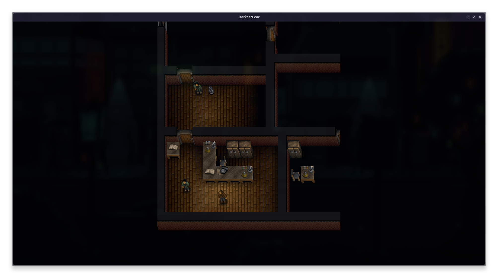

# Darkest Fear

A libGDX desktop and Android port of the J2ME game **Darkest Fear**, running the
original game code on top of a small J2ME → libGDX compatibility layer.





## Build

The original game is **not** included. You must supply the **v1.55** JAR yourself
and place it at:

```
./libs/darkest_fear_v155.jar
```

Requires JDK 21.

### Desktop

```
./gradlew lwjgl3:run
```

### Android

Requires the Android SDK (set `ANDROID_HOME`, or add an `sdk.dir` entry to
`local.properties`).

Build a debug APK:

```
./gradlew :android:assembleDebug
```

The APK is written to `android/build/outputs/apk/debug/android-debug.apk`.

Build and install directly to a connected device:

```
./gradlew :android:installDebug
```

## Controls

| Key | Action |
| --- | --- |
| Arrow keys | Navigate |
| Enter / Space | Select |
| Q | Left soft key |
| E | Right soft key |
| 0 – 9 | Number keys |

## Status

- [x] Boot
- [x] Main menu
- [x] Text rendering
- [x] Input
- [x] Save data
- [x] Sound
- [x] Gameplay
- [x] Android

## How does it work

J2ME apps are compiled to ordinary JVM bytecode (with CLDC preverification and a restricted class library). Any modern JVM can still load and run that bytecode — what's missing is the platform layer, `javax.microedition.*`, which on a real device bridged the app to the handset's screen, input, and sound.

This project reimplements that platform layer so the original game runs unmodified outside a J2ME environment.

### Emulator vs port

An emulator reproduces a whole device — CPU, hardware, and all — and runs the app as a guest inside it. This does neither. The original bytecode executes natively on the host's Java runtime, and its graphics and input calls are mapped directly onto [libGDX](https://libgdx.com/).

So it's a port rather than an emulator: one game, running on its own code, with a thin compatibility layer standing in for the phone.
