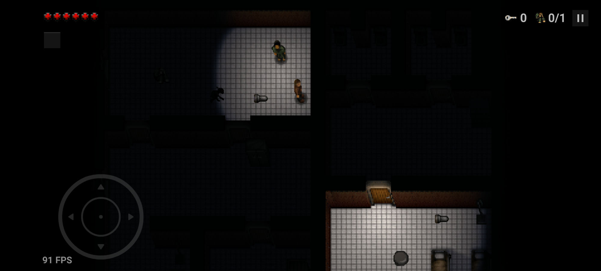
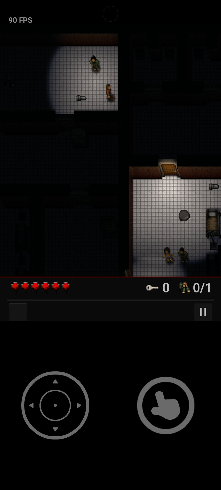

# Darkest Fear

A libGDX desktop and Android port of the J2ME game **Darkest Fear**, running the
original game code on top of a small J2ME → libGDX compatibility layer.





## Play

The original game is **not** included. You must supply the **v1.55** JAR
(240x320) yourself. The game asks for it the first time it starts.

Builds for Linux, Windows, macOS and Android are on the
[Releases](../../releases) page.

## Controls

| Action | Keyboard | Gamepad | Touch |
| --- | --- | --- | --- |
| Move | WASD / Arrow keys | Stick / D-pad | Stick |
| Interact | E / Space / Enter | A | Tap |
| Pause / Back | Q / Esc | B / Start | Pause button |

Keys can be changed in Settings.

## Build

### Requirements

- JDK 21
- Android SDK, for the Android build (set `ANDROID_HOME`, or add an `sdk.dir`
  entry to `local.properties`)

### Launch in debug mode

```
./gradlew lwjgl3:run
```

### Package a standalone build

Linux:

```
./gradlew lwjgl3:packageLinuxX64
```

Windows:

```
./gradlew lwjgl3:packageWinX64
```

macOS (Intel):

```
./gradlew lwjgl3:packageMacX64
```

macOS (Apple Silicon):

```
./gradlew lwjgl3:packageMacM1
```

The zips are written to `lwjgl3/build/construo/dist/`.

Android:

```
./gradlew android:assembleRelease
```

The APK is written to `android/build/outputs/apk/release/`.

## Status

- [x] Boot
- [x] Main menu
- [x] Text rendering
- [x] Input
- [x] Save data
- [x] Sound
- [x] Gameplay
- [x] Android

## How does it work

J2ME apps are compiled to ordinary JVM bytecode (with CLDC preverification and a restricted class library). Any modern JVM can still load and run that bytecode — what's missing is the platform layer, `javax.microedition.*`, which on a real device bridged the app to the handset's screen, input, and sound.

This project reimplements that platform layer so the original game runs unmodified outside a J2ME environment.

### Emulator vs port

An emulator reproduces a whole device — CPU, hardware, and all — and runs the app as a guest inside it. This does neither. The original bytecode executes natively on the host's Java runtime, and its graphics and input calls are mapped directly onto [libGDX](https://libgdx.com/).

So it's a port rather than an emulator: one game, running on its own code, with a thin compatibility layer standing in for the phone.
